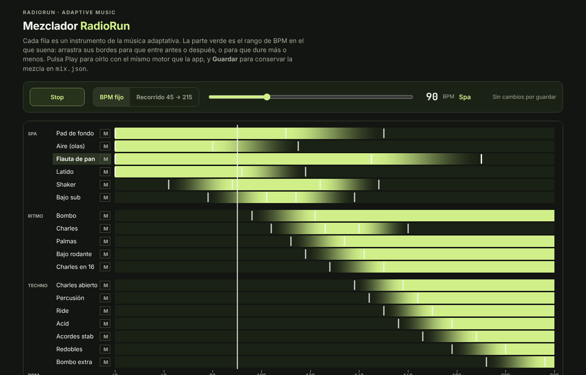

# Mezclador

Una página para decidir **en qué rango de BPM suena cada instrumento** de la música adaptativa de [RadioRun](https://github.com/cvergaraqec-blip/RadioRun-App) y con qué volumen, escuchándolo en vivo con los mismos sonidos y el mismo secuenciador que la app.



## Abrirlo

Necesitas [Node.js](https://nodejs.org) (versión 18 o más nueva). No hace falta instalar nada más.

```bash
git clone https://github.com/orlandoqueb/MezcladorRR.git
cd MezcladorRR
node server.cjs
```

Abre http://localhost:8099 en el navegador. Para cerrarlo, `Ctrl+C`.

## Usarlo

- **Mapa:** cada fila es un instrumento. La parte verde es el rango de BPM en que suena; el degradado es donde entra o sale poco a poco. Arrastra las **barras blancas** para que entre antes o después, o para que dure más o menos.
- **Instrumento:** abajo puedes escribir los BPM exactos, hacer que siga sonando hasta 220 y cambiar su volumen.
- **Play:** con **BPM fijo** (el deslizador) o en un **Recorrido** de 45 a 215 BPM en 2 min 30 s. Los cambios se oyen al momento.
- **M:** silencia una fila solo para escuchar el resto; no se guarda.
- **Tus loops:** arrastra un WAV o MP3 e indica cuántos beats dura. Sigue el BPM sin cambiar de tono, como la música de Training. Solo se escucha mientras la página está abierta: no se guarda.
- **Guardar:** escribe tu mezcla en `mix.json`. Haz commit de ese archivo para compartirla.

## Archivos

| Archivo | Qué es |
|---|---|
| `index.html` | La página del Mezclador |
| `server.cjs` | Servidor local: sirve la página y los sonidos, y guarda `mix.json` |
| `song.json` | La canción: las 18 capas, sus patrones y sus rangos de BPM originales |
| `kit/` | Los 47 sonidos de la canción (WAV) |
| `mix.json` | Tu mezcla: solo lo que cambia respecto a `song.json` (aparece al guardar) |

`song.json` y `kit/` vienen de RadioRun (`scripts/adaptive/song.cjs` y `kit.cjs`), en la versión tranquila: pad suave sin vaivén, flauta de pan en lugar de campanas y olas más bajas. Todos los sonidos son originales, generados por código; no hay grabaciones de terceros.

## Llevar la mezcla a RadioRun

`mix.json` tiene la forma `{ "flute": { "out": [145, 190] }, "air": { "gain": 0.1 } }`: por cada instrumento, solo los valores que cambiaste (`in` y `out` en BPM, `gain` de volumen). Pásale ese archivo a quien mantiene la música de la app (o a Claude) para aplicarlo en `scripts/adaptive/`.
